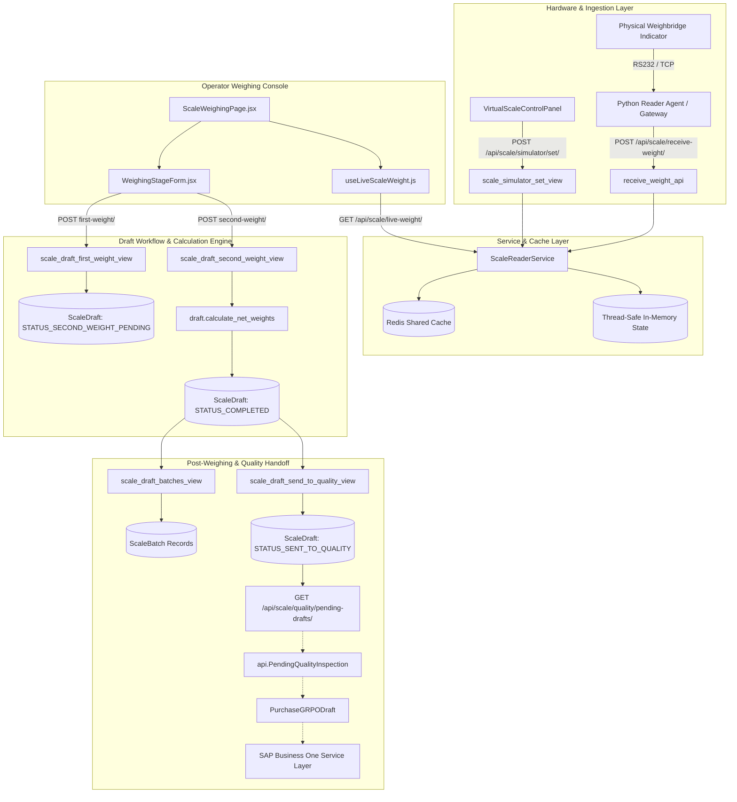

# COMPLETE CODE-LEVEL FUNCTIONAL AUDIT REPORT
## Scale & Weighbridge Module (MEEM Production System)

---

### Table of Contents
1. [Executive Summary](#1-executive-summary)
2. [Actual End-to-End Workflow](#2-actual-end-to-end-workflow)
3. [Module / File Map](#3-module--file-map)
4. [Database Models & Schemas](#4-database-models--schemas)
5. [API Map & Endpoint Specifications](#5-api-map--endpoint-specifications)
6. [Weight Calculation Logic](#6-weight-calculation-logic)
7. [First vs Second Weighing Workflow](#7-first-vs-second-weighing-workflow)
8. [Affected Weight Elements (Tare / Additive)](#8-affected-weight-elements-tare--additive)
9. [Live Scale Reader Architecture](#9-live-scale-reader-architecture)
10. [Virtual Scale Simulator](#10-virtual-scale-simulator)
11. [Vehicle & Movement Workflow](#11-vehicle--movement-workflow)
12. [Draft Workflow & Lifecycle](#12-draft-workflow--lifecycle)
13. [Batch / Pivot Distribution Logic](#13-batch--pivot-distribution-logic)
14. [Printing, Tickets & Permits](#14-printing-tickets--permits)
15. [Scale → Quality Integration](#15-scale--quality-integration)
16. [Quality → GRPO → SAP Integration Trace](#16-quality--grpo--sap-integration-trace)
17. [Frontend Architecture](#17-frontend-architecture)
18. [Backend Architecture](#18-backend-architecture)
19. [Permissions, Access Control & Roles](#19-permissions-access-control--roles)
20. [Error Handling & Edge Cases](#20-error-handling--edge-cases)
21. [Automated Test Suite Analysis](#21-automated-test-suite-analysis)
22. [Actual Implementation vs Documented Design](#22-actual-implementation-vs-documented-design)
23. [Proven Code Limitations](#23-proven-code-limitations)
24. [Final Architecture & Dataflow Diagram](#24-final-architecture--dataflow-diagram)
25. [Complete Traceability Matrix](#25-complete-traceability-matrix)
26. [What the Scale Module Really Does Today](#what-the-scale-module-really-does-today)

---

## 1. Executive Summary

### Plain-Language Business Summary
The **Scale / Weighbridge Module** is an operational subsystem designed to capture, calculate, audit, and distribute certified weights of agricultural trucks entering and exiting the processing plant.

In non-technical business terms, the system performs the following sequence:
1. **Gate Entry & Vehicle Tracking:** When a truck arrives, the gate operator logs the truck plate number, driver, company, and arrival time. The truck enters the facility.
2. **First Weighing (Loaded / Gross):** The loaded truck mounts the weighbridge scale. The system connects to digital indicators (physical COM/IP or virtual simulator), continuously checks for signal stability, and reads the gross weight. The operator selects the vehicle, vendor, and item, and specifies tare elements (e.g., wooden pallets or plastic crates to deduct). Recording the first weight creates an open **Scale Draft Ticket** (`STATUS_SECOND_WEIGHT_PENDING`).
3. **Offloading & Second Weighing (Empty / Tare):** The truck unloads its agricultural crop inside the plant and returns to the weighbridge. The operator resumes the existing draft ticket, verifies the tare elements, reads the empty truck weight, and captures the second weight.
4. **Certified Net Weight Calculation:** The system computes the net loaded weight, net empty weight, and net certified product weight (`product_weight = |net_loaded - net_empty|`). The draft ticket transitions to `STATUS_COMPLETED`.
5. **Multi-Supplier / Pivot Distribution:** If a single truck carried crop from multiple farms or pivot pivots, the operator can split the net product weight across batches proportionally by box count or manually.
6. **Handoff to Quality Inspection:** Once certified, the draft is marked as `SENT_TO_QUALITY`, exposing the draft and batch breakdown to the Quality Inspection module.

---

## 2. Actual End-to-End Workflow

Below is the step-by-step trace of what happens in the actual code at each phase:

```
[Truck Arrives at Gate]
         │
         ▼
[VehicleEntryModal.jsx] ─── POST /api/scale/vehicles/entry/ ───► ScaleVehicle + ScaleVehicleMovement (is_inside=True)
         │
         ▼
[ScaleWeighingPage.jsx (Step 1)]
   ├── useLiveScaleWeight.js ─── GET /api/scale/live-weight/ ◄─── ScaleReaderService (Redis / In-Memory)
   ├── Operator selects Vehicle, Vendor, Item, Tare Elements
   └── Form Submit ─── POST /api/scale/drafts/first-weight/
         │
         ▼
[scale_draft_first_weight_view (views.py)]
   ├── Creates ScaleDraft (start_type="loaded", status="SECOND_WEIGHT_PENDING")
   ├── Creates ScaleDraftElement records (stage="loaded", action="remove")
   ├── Calls draft.calculate_net_weights() (net_weight_loaded = weight_loaded - elements_weight)
   └── Returns ScaleDraftDetailSerializer (Draft #SD-YYYYMMDD-XXXX)
         │
         ▼
[Truck Unloads Inside Plant & Returns to Scale]
         │
         ▼
[ScaleWeighingPage.jsx (Step 2) or ScaleDraftsPage.jsx Resume]
   ├── Loads Draft with pre-existing elements (persisted from Step 1)
   ├── useLiveScaleWeight.js reads empty weight & stability
   └── Form Submit ─── POST /api/scale/drafts/{id}/second-weight/
         │
         ▼
[scale_draft_second_weight_view (views.py)]
   ├── Saves weight_empty & empty_time
   ├── Adds any new empty-stage elements (without duplicating loaded-stage elements)
   ├── Calls draft.calculate_net_weights()
   │     ├── net_weight_empty = weight_empty - empty_elements
   │     ├── product_weight = |net_weight_loaded - net_weight_empty|
   │     └── status = "COMPLETED", is_closed = True
   └── Returns completed Draft
         │
         ▼
[Step 3: PivotBatchDistributionTable.jsx] (Optional)
   └── POST /api/scale/drafts/{id}/batches/ ───► Recreates ScaleBatch records (auto/manual %)
         │
         ▼
[Step 4: ScaleDraftSummaryCard.jsx]
   ├── Print Ticket (window.print() browser ticket)
   └── Send to Quality ─── POST /api/scale/drafts/{id}/send-to-quality/ ───► status = "SENT_TO_QUALITY"
         │
         ▼
[Quality Module Access]
   └── GET /api/scale/quality/pending-drafts/ ───► lists closed drafts with product_weight & batches
```

---

## 3. Module / File Map

### Backend Files (`backend/scale/` & `backend/api/`)

| File Path | Primary Responsibility | Important Classes / Functions | Invoked By | Invokes |
|---|---|---|---|---|
| `backend/scale/models.py` | Defines ORM models and mathematical weight calculations | `ScaleDevice`, `ScaleVehicle`, `ScaleVehicleMovement`, `ScaleItemElement`, `ScaleDraft`, `ScaleDraftElement`, `ScaleBatch`, `ScalePermit` | Views, Admin, Serializers, Tests, Quality models | Django ORM, `settings.AUTH_USER_MODEL` |
| `backend/scale/serializers.py` | DRF Serializers for validation, object representation, and data formatting | `ScaleDeviceSerializer`, `ScaleVehicleSerializer`, `ScaleVehicleMovementSerializer`, `ScaleItemElementSerializer`, `ScaleDraftListSerializer`, `ScaleDraftDetailSerializer`, `ScaleDraftElementSerializer`, `ScaleBatchSerializer`, `ScalePermitSerializer` | `backend/scale/views.py` | `backend/scale/models.py` |
| `backend/scale/views.py` | REST API endpoint handlers, transaction control, permission enforcement | `live_weight_view`, `receive_weight_api`, `scale_devices_collection`, `scale_device_detail`, `scale_vehicles_collection`, `scale_vehicle_entry`, `scale_vehicle_exit`, `scale_item_elements_collection`, `scale_item_element_detail`, `scale_drafts_list_view`, `scale_draft_detail_view`, `scale_draft_first_weight_view`, `scale_draft_second_weight_view`, `scale_draft_elements_view`, `scale_draft_batches_view`, `scale_draft_send_to_quality_view`, `scale_draft_cancel_view`, `quality_pending_scale_drafts_view`, `scale_simulator_set_view`, `scale_simulator_status_view` | `backend/scale/urls.py` | `models.py`, `serializers.py`, `services/scale_reader.py`, `api/role_permissions.py` |
| `backend/scale/urls.py` | URL routing for all `/api/scale/*` endpoints | `urlpatterns` | `backend/receipt_project/urls.py` | `backend/scale/views.py` |
| `backend/scale/services/scale_reader.py` | Singleton service for scale readings, regex ASCII parsing, stability detection, Redis shared caching, in-memory state | `parse_raw_weight`, `ScaleDeviceState`, `ScaleReaderService`, `scale_reader_service` | `views.py`, `tests.py` | `django.core.cache`, `re`, `threading`, `time` |
| `backend/scale/admin.py` | Django Admin registrations and filter definitions | `ScaleDeviceAdmin`, `ScaleVehicleAdmin`, `ScaleVehicleMovementAdmin`, `ScaleItemElementAdmin`, `ScaleDraftAdmin`, `ScaleDraftElementInline`, `ScaleBatchInline`, `ScaleBatchAdmin`, `ScalePermitAdmin` | Django Admin | `backend/scale/models.py` |
| `backend/scale/apps.py` | Django App configuration | `ScaleConfig` (`name = "scale"`) | `settings.INSTALLED_APPS` | Django App Registry |
| `backend/scale/migrations/0001_initial.py` | Database migration schema for all scale models | `Migration` | `python manage.py migrate` | Database |
| `backend/scale/tests.py` | Automated unit and integration test suite | `ScaleReaderServiceTestCase`, `ScaleWorkflowAPIsTestCase` (15 test methods) | `python manage.py test scale` | `views.py`, `models.py`, `services/scale_reader.py` |
| `backend/api/role_permissions.py` | RBAC role definitions and permission helpers | `ROLE_SCALE_ADMIN`, `ROLE_SCALE_OPERATOR`, `can_access_scale`, `can_manage_scale`, `is_scale_admin`, `is_scale_operator` | `backend/scale/views.py`, `backend/api/views.py` | Django auth UserProfile |
| `backend/api/models_quality.py` | Quality Inspection model linking to ScaleDraft | `PendingQualityInspection.scale_draft` | Quality views and workflows | `scale.models.ScaleDraft` |

### Frontend Files (`frontend/src/modules/scale/` & routing)

| File Path | Primary Responsibility | Important Components / Functions | Invoked By | Invokes |
|---|---|---|---|---|
| `frontend/src/modules/scale/pages/ScaleLandingPage.jsx` | Navigation Hub / Landing Page with quick action cards | `ScaleLandingPage` | `App.jsx` (`/scale`) | `useNavigate`, `useI18n`, `useAuth`, `roles.js` |
| `frontend/src/modules/scale/pages/ScaleWeighingPage.jsx` | Main dual-column weighing console (Stepper, forms, live weight readout, simulator) | `ScaleWeighingPage` | `App.jsx` (`/scale/weighing`) | `useLiveScaleWeight`, `useScaleDraftWorkflow`, `WeighingStageForm`, `LiveWeightDisplay`, `VirtualScaleControlPanel`, `PivotBatchDistributionTable`, `ScaleDraftSummaryCard`, `ScaleStepper`, `VehicleEntryModal`, `ConfirmDialog`, `scaleApi` |
| `frontend/src/modules/scale/pages/ScaleDraftsPage.jsx` | Drafts management table, status tabs, search, filter, cancel dialog | `ScaleDraftsPage` | `App.jsx` (`/scale/drafts`) | `scaleApi`, `LoadingSkeleton`, `EmptyState`, `PageHeader` |
| `frontend/src/modules/scale/pages/ScaleDraftDetailPage.jsx` | Read-only details and certified breakdown of a single draft ticket | `ScaleDraftDetailPage` | `App.jsx` (`/scale/drafts/:draftId`) | `scaleApi`, `useScaleDraftWorkflow`, `ScaleDraftSummaryCard`, `ConfirmDialog` |
| `frontend/src/modules/scale/pages/ScaleDevicesPage.jsx` | Weighbridge device management (COM, IP, baud rate, virtual device management) | `ScaleDevicesPage` | `App.jsx` (`/scale/devices`) | `scaleApi`, `useToast`, `PageHeader`, `LoadingSkeleton` |
| `frontend/src/modules/scale/pages/ScaleItemElementsPage.jsx` | Tare items configuration (wood pallets, plastic crates, tare unit weights) | `ScaleItemElementsPage` | `App.jsx` (`/scale/item-elements`) | `scaleApi`, `useToast`, `PageHeader`, `LoadingSkeleton` |
| `frontend/src/modules/scale/components/LiveWeightDisplay.jsx` | Large digital weight display with live stability and online badges | `LiveWeightDisplay` | `ScaleWeighingPage.jsx` | `useI18n` |
| `frontend/src/modules/scale/components/WeighingStageForm.jsx` | First and second weight capture form, vehicle/driver selection, tare elements adjustment | `WeighingStageForm` | `ScaleWeighingPage.jsx` | `scaleApi`, `ResponsiveSelect`, `useI18n` |
| `frontend/src/modules/scale/components/VirtualScaleControlPanel.jsx` | Development/simulator control panel (presets, manual weight, stable/online toggles) | `VirtualScaleControlPanel` | `ScaleWeighingPage.jsx` | `scaleApi`, `useToast`, `useI18n` |
| `frontend/src/modules/scale/components/PivotBatchDistributionTable.jsx` | Multi-farm/batch allocation table with auto/manual percentage calculator | `PivotBatchDistributionTable` | `ScaleWeighingPage.jsx` | `useI18n` |
| `frontend/src/modules/scale/components/ScaleDraftSummaryCard.jsx` | Summary card showing gross, tare, net product weight, print and send to quality actions | `ScaleDraftSummaryCard` | `ScaleWeighingPage.jsx`, `ScaleDraftDetailPage.jsx` | `useI18n` |
| `frontend/src/modules/scale/components/ScaleStepper.jsx` | 3-step progress bar (First Weight → Second Weight → Send to Quality) | `ScaleStepper` | `ScaleWeighingPage.jsx` | `useI18n` |
| `frontend/src/modules/scale/components/VehicleEntryModal.jsx` | Gate modal dialog to register new vehicle entry | `VehicleEntryModal` | `ScaleWeighingPage.jsx` | `scaleApi`, `useToast`, `useI18n` |
| `frontend/src/modules/scale/hooks/useLiveScaleWeight.js` | Custom polling hook (750ms interval) to stream live weight and stability | `useLiveScaleWeight` | `ScaleWeighingPage.jsx` | `scaleApi.getLiveWeight` |
| `frontend/src/modules/scale/hooks/useScaleDraftWorkflow.js` | State machine hook managing first weight, second weight, batches, cancel, and quality handoff | `useScaleDraftWorkflow` | `ScaleWeighingPage.jsx`, `ScaleDraftDetailPage.jsx` | `scaleApi` |
| `frontend/src/modules/scale/services/scaleApi.js` | Axios HTTP client wrapper for all `/api/scale/*` endpoints | `scaleApi` | All scale pages and components | `frontend/src/services/api.js` |
| `frontend/src/utils/roles.js` | Frontend role checking utilities | `canAccessScale`, `canManageScale`, `isScaleAdmin`, `isScaleOperator` | `App.jsx`, `ScaleLandingPage.jsx` | `AuthContext` |

---

## 4. Database Models & Schemas

All models reside in `backend/scale/models.py` and are registered under the Django app `scale`.

### 1. `ScaleDevice` (`scale_scaledevice`)
Represents physical indicator terminals and virtual scales.
- `id` (AutoField, PK)
- `device_id` (CharField, max_length=100, unique=True, indexed): e.g., `"scale_001"`, `"scale_virtual_001"`
- `device_name` (CharField, max_length=200): e.g., `"Weighbridge Gate 1"`
- `device_type` (CharField, max_length=20, choices: `local`, `remote`, `virtual`, default=`local`)
- `com_port` (CharField, max_length=50, null=True, blank=True): e.g., `"COM3"`
- `baud_rate` (IntegerField, default=9600): `9600`, `19200`, `115200`
- `ip_address` (GenericIPAddressField, null=True, blank=True)
- `port` (IntegerField, default=80, null=True, blank=True)
- `location` (CharField, max_length=200, blank=True): e.g., `"Gate 1"`
- `is_active` (BooleanField, default=True, indexed)
- `last_seen` (DateTimeField, null=True, blank=True)
- `created_at` / `updated_at` (DateTimeField)
- **Calculated Properties:** `is_online` (`(now - last_seen).total_seconds() < 30`)

### 2. `ScaleVehicle` (`scale_scalevehicle`)
Master record of trucks and transport vehicles.
- `id` (AutoField, PK)
- `vehicle_number` (CharField, max_length=50, unique=True, indexed): e.g., `"TRUCK-1024"`
- `driver_name` (CharField, max_length=150, blank=True)
- `driver_id` (CharField, max_length=50, blank=True): National ID
- `phone` (CharField, max_length=50, blank=True)
- `company` (CharField, max_length=150, blank=True)
- `vehicle_type` (CharField, max_length=20, choices: `weighing`, `visit`, default=`weighing`)
- `notes` (TextField, blank=True)
- `created_at` / `updated_at` (DateTimeField)
- **Calculated Properties:**
  - `is_inside`: checks if the latest `ScaleVehicleMovement` has `exit_time IS NULL`.
  - `current_status`: `"متواجدة"` (inside) or `"مغادرة"` (departed).

### 3. `ScaleVehicleMovement` (`scale_scalevehiclemovement`)
Audit log of gate entry and exit events.
- `id` (AutoField, PK)
- `vehicle` (ForeignKey → `ScaleVehicle`, on_delete=CASCADE, related_name=`movements`)
- `driver_name` (CharField, max_length=150, blank=True)
- `entry_time` (DateTimeField, default=`timezone.now`)
- `exit_time` (DateTimeField, null=True, blank=True)
- `notes` (TextField, blank=True)
- `created_by` (ForeignKey → `User`, on_delete=SET_NULL, null=True, blank=True)
- `created_at` / `updated_at` (DateTimeField)
- **Calculated Properties:** `is_active` (`exit_time is None`), `duration` (`exit_time - entry_time`).

### 4. `ScaleItemElement` (`scale_scaleitemelement`)
Master tare item weights per item code.
- `id` (AutoField, PK)
- `item_code` (CharField, max_length=100, indexed): SAP Item Code, e.g., `"ITEM-STRAWBERRY"`
- `item_name` (CharField, max_length=200, blank=True)
- `name` (CharField, max_length=150): e.g., `"Wood Pallet"`, `"Plastic Crate"`
- `weight` (DecimalField, max_digits=10, decimal_places=2): e.g., `20.00` kg
- `is_active` (BooleanField, default=True, indexed)
- `created_at` / `updated_at` (DateTimeField)
- **Unique Constraint:** `unique_together = [("item_code", "name")]`

### 5. `ScaleDraft` (`scale_scaledraft`)
Core weighing ticket model.
- `id` (AutoField, PK)
- `draft_number` (CharField, max_length=100, unique=True, indexed): Formatted as `SD-YYYYMMDD-XXXX`
- `start_type` (CharField, max_length=10, choices: `loaded`, `empty`, default=`loaded`)
- `vehicle` (ForeignKey → `ScaleVehicle`, null=True, blank=True, on_delete=SET_NULL, related_name=`drafts`)
- `is_direct_entry` (BooleanField, default=False)
- `direct_vehicle_number` (CharField, max_length=50, blank=True)
- `direct_driver_name` (CharField, max_length=150, blank=True)
- `item_code` (CharField, max_length=100, indexed)
- `item_name` (CharField, max_length=200, blank=True)
- `vendor_card_code` (CharField, max_length=100, blank=True, indexed)
- `vendor_name` (CharField, max_length=200, blank=True)
- `scale_device` (ForeignKey → `ScaleDevice`, null=True, blank=True, on_delete=SET_NULL, related_name=`drafts`)
- `weight_loaded` (DecimalField(12, 2), null=True, blank=True)
- `net_weight_loaded` (DecimalField(12, 2), null=True, blank=True)
- `loaded_time` (DateTimeField, null=True, blank=True)
- `weight_empty` (DecimalField(12, 2), null=True, blank=True)
- `net_weight_empty` (DecimalField(12, 2), null=True, blank=True)
- `empty_time` (DateTimeField, null=True, blank=True)
- `product_weight` (DecimalField(12, 2), null=True, blank=True): Final certified weight
- `use_batches` (BooleanField, default=False)
- `total_boxes` (PositiveIntegerField, default=0)
- `auto_distribution` (BooleanField, default=True)
- `status` (CharField, max_length=30, choices: `FIRST_WEIGHT`, `SECOND_WEIGHT_PENDING`, `COMPLETED`, `SENT_TO_QUALITY`, `CANCELLED`, default=`FIRST_WEIGHT`, indexed)
- `is_closed` (BooleanField, default=False, indexed)
- `permit_printed` (BooleanField, default=False)
- `permit_printed_at` (DateTimeField, null=True, blank=True)
- `final_card_printed` (BooleanField, default=False)
- `final_card_printed_at` (DateTimeField, null=True, blank=True)
- `created_by` (ForeignKey → `User`, null=True, blank=True, on_delete=SET_NULL, related_name=`created_scale_drafts`)
- `closed_by` (ForeignKey → `User`, null=True, blank=True, on_delete=SET_NULL, related_name=`closed_scale_drafts`)
- `notes` (TextField, blank=True)
- `created_at` / `updated_at` (DateTimeField)
- **Model Methods:**
  - `calculate_net_weights()`: Core calculation routine (see [Section 6](#6-weight-calculation-logic)).
  - `save()`: Auto-generates `draft_number = SD-YYYYMMDD-XXXX` if not set.

### 6. `ScaleDraftElement` (`scale_scaledraftelement`)
Line items of tare elements attached to a specific draft stage.
- `id` (AutoField, PK)
- `draft` (ForeignKey → `ScaleDraft`, on_delete=CASCADE, related_name=`draft_elements`)
- `item_element` (ForeignKey → `ScaleItemElement`, on_delete=PROTECT, related_name=`draft_elements`)
- `count` (PositiveIntegerField, default=1)
- `stage` (CharField, max_length=10, choices: `loaded`, `empty`, default=`loaded`)
- `action` (CharField, max_length=10, choices: `add`, `remove`, default=`remove`)
- `unit_weight` (DecimalField(10, 2), default=0.00)
- `total_weight` (DecimalField(12, 2), default=0.00)
- `created_at` / `updated_at` (DateTimeField)
- **Calculated Properties:** `signed_weight` (`-total_weight` if `action == "remove"` else `+total_weight`).
- **Model Methods:** `save()` auto-calculates `total_weight = (unit_weight * count).quantize(Decimal("0.01"))`.

### 7. `ScaleBatch` (`scale_scalebatch`)
Batch / Pivot breakdown for multiple suppliers or sub-shipments in one truck.
- `id` (AutoField, PK)
- `draft` (ForeignKey → `ScaleDraft`, on_delete=CASCADE, related_name=`batches`)
- `supplier_card_code` (CharField, max_length=100, blank=True)
- `supplier_name` (CharField, max_length=200)
- `batch_number` (CharField, max_length=100, blank=True)
- `box_count` (PositiveIntegerField, default=1)
- `box_weight` (DecimalField(10, 2), default=25.00)
- `percentage` (DecimalField(6, 2), default=0.00)
- `actual_weight` (DecimalField(12, 2), default=0.00)
- `division_mode` (CharField, max_length=10, choices: `auto`, `manual`, default=`auto`)
- `created_at` / `updated_at` (DateTimeField)
- **Calculated Properties:** `estimated_weight = (box_count * box_weight).quantize(Decimal("0.01"))`.

### 8. `ScalePermit` (`scale_scalepermit`)
Formal gate weighbridge permit/pass document.
- `id` (AutoField, PK)
- `draft` (OneToOneField → `ScaleDraft`, on_delete=CASCADE, related_name=`permit`)
- `permit_number` (CharField, max_length=100, unique=True, blank=True): Formatted as `SP-YYYYMMDD-XXXX`
- `permit_type` (CharField, max_length=10, choices: `entry`, `exit`, `both`, default=`both`)
- `driver_name` / `driver_id` / `phone` / `company` / `purpose` / `supplier` / `notes` (Char/Text fields)
- `entry_time` (DateTimeField, default=`timezone.now`)
- `exit_time` (DateTimeField, null=True, blank=True)
- `include_batches_info` (BooleanField, default=False)
- `batch_details` (TextField, blank=True)
- `created_by` (ForeignKey → `User`, null=True, blank=True, on_delete=SET_NULL)
- `created_at` / `updated_at` (DateTimeField)
- **Model Methods:** `save()` auto-generates `permit_number = SP-YYYYMMDD-XXXX`.

---

## 5. API Map & Endpoint Specifications

All endpoints are registered under `/api/scale/` in `backend/scale/urls.py` and handled by `backend/scale/views.py`.

| Method | Endpoint | Handler | Permission | Request Body | Response Success | Database Mutations |
|---|---|---|---|---|---|---|
| `GET` | `/api/scale/live-weight/` | `live_weight_view` | `require_scale_access` | Query params: `?device_id=...` | `{success: true, data: {...}}` | Updates `ScaleDevice.last_seen` |
| `POST` | `/api/scale/receive-weight/` | `receive_weight_api` | Public / Ingestion | `{device_id, weight, is_stable, raw_data}` | `{success: true, data: {...}}` | Ingests into Redis/Memory, updates `ScaleDevice.last_seen` |
| `GET` | `/api/scale/devices/` | `scale_devices_collection` | `require_scale_access` | None | `{success: true, data: {devices: [...], live_states: [...]}}` | None |
| `POST` | `/api/scale/devices/` | `scale_devices_collection` | `can_manage_scale` (Admin) | `{device_id, device_name, device_type, com_port, baud_rate, ip_address, port, location}` | `{success: true, data: {...}}` (201) | Creates `ScaleDevice` |
| `GET` | `/api/scale/devices/<id>/` | `scale_device_detail` | `require_scale_access` | None | `{success: true, data: {...}}` | None |
| `PUT` | `/api/scale/devices/<id>/` | `scale_device_detail` | `can_manage_scale` (Admin) | Partial update payload | `{success: true, data: {...}}` | Updates `ScaleDevice` |
| `DELETE` | `/api/scale/devices/<id>/` | `scale_device_detail` | `can_manage_scale` (Admin) | None | `{success: true, message: "..."}` | Deletes `ScaleDevice` |
| `GET` | `/api/scale/vehicles/` | `scale_vehicles_collection` | `require_scale_access` | Query params: `?inside_only=true&search=...` | `{success: true, data: [...]}` | None |
| `POST` | `/api/scale/vehicles/` | `scale_vehicles_collection` | `require_scale_access` | `{vehicle_number, driver_name, phone, company, vehicle_type, notes}` | `{success: true, data: {...}}` (201) | Creates `ScaleVehicle` |
| `POST` | `/api/scale/vehicles/entry/` | `scale_vehicle_entry` | `require_scale_access` | `{vehicle_number, driver_name, company, notes}` | `{success: true, data: {vehicle, movement}}` (201) | Creates `ScaleVehicleMovement` (`exit_time=None`) |
| `POST` | `/api/scale/vehicles/exit/` | `scale_vehicle_exit` | `require_scale_access` | `{vehicle_id}` or `{vehicle_number}` | `{success: true, data: movement}` | Sets `ScaleVehicleMovement.exit_time = now()` |
| `GET` | `/api/scale/item-elements/` | `scale_item_elements_collection` | `require_scale_access` | Query params: `?item_code=...` | `{success: true, data: [...]}` | None |
| `POST` | `/api/scale/item-elements/` | `scale_item_elements_collection` | `can_manage_scale` (Admin) | `{item_code, item_name, name, weight, is_active}` | `{success: true, data: {...}}` (201) | Creates `ScaleItemElement` |
| `GET` | `/api/scale/item-elements/<id>/` | `scale_item_element_detail` | `require_scale_access` | None | `{success: true, data: {...}}` | None |
| `PUT` | `/api/scale/item-elements/<id>/` | `scale_item_element_detail` | `can_manage_scale` (Admin) | Partial update payload | `{success: true, data: {...}}` | Updates `ScaleItemElement` |
| `GET` | `/api/scale/drafts/` | `scale_drafts_list_view` | `require_scale_access` | Query params: `?status=...&is_closed=...&search=...` | `{success: true, data: [...]}` | None |
| `GET` | `/api/scale/drafts/<id>/` | `scale_draft_detail_view` | `require_scale_access` | None | `{success: true, data: {...}}` | None |
| `POST` | `/api/scale/drafts/first-weight/` | `scale_draft_first_weight_view` | `require_scale_access` | `{start_type, weight, vehicle_id, direct_vehicle_number, direct_driver_name, item_code, item_name, vendor_card_code, vendor_name, elements: [{item_element_id, count, action}]}` | `{success: true, data: {...}}` (201) | Creates `ScaleDraft` & `ScaleDraftElement` |
| `POST` | `/api/scale/drafts/<id>/second-weight/` | `scale_draft_second_weight_view` | `require_scale_access` | `{weight, elements: [{item_element_id, count, action}]}` | `{success: true, data: {...}}` | Updates `ScaleDraft`, creates stage 2 elements, closes draft |
| `POST` | `/api/scale/drafts/<id>/elements/` | `scale_draft_elements_view` | `require_scale_access` | `{action_type: "add_or_update"\|"delete", item_element_id, count, stage, action, draft_element_id}` | `{success: true, data: {...}}` | Modifies `ScaleDraftElement`, recalculates draft |
| `POST` | `/api/scale/drafts/<id>/batches/` | `scale_draft_batches_view` | `require_scale_access` | `{total_boxes, auto_distribution, batches: [...]}` | `{success: true, data: {...}}` | Replaces `ScaleBatch` items |
| `POST` | `/api/scale/drafts/<id>/send-to-quality/` | `scale_draft_send_to_quality_view` | `require_scale_access` | None | `{success: true, data: {...}}` | `ScaleDraft.status = "SENT_TO_QUALITY"` |
| `POST` | `/api/scale/drafts/<id>/cancel/` | `scale_draft_cancel_view` | `require_scale_access` | None | `{success: true, data: {...}}` | `ScaleDraft.status = "CANCELLED"`, `is_closed = True` |
| `GET` | `/api/scale/quality/pending-drafts/` | `quality_pending_scale_drafts_view` | `require_scale_or_quality_access` | None | `{success: true, data: [...]}` | None |
| `POST` | `/api/scale/simulator/set/` | `scale_simulator_set_view` | `require_scale_access` | `{device_id, weight, is_stable, is_online, error}` | `{success: true, data: {...}}` | Updates simulator state (virtual devices only) |
| `GET` | `/api/scale/simulator/status/` | `scale_simulator_status_view` | `require_scale_access` | None | `{success: true, data: [...]}` | None |

---

## 6. Weight Calculation Logic

The mathematical calculation logic is centrally implemented in `backend/scale/models.py` inside `ScaleDraft.calculate_net_weights()` and `ScaleDraftElement.signed_weight`.

### Exact Formulas

#### 1. Element Adjustment per Line Item:
$$\text{Element Total Weight} = \text{unit\_weight} \times \text{count}$$
$$\text{Element Signed Weight} = \begin{cases} -(\text{Element Total Weight}), & \text{if } \text{action} = \text{"remove"} \\ +(\text{Element Total Weight}), & \text{if } \text{action} = \text{"add"} \end{cases}$$

#### 2. Net Loaded Weight:
$$\text{Net Weight Loaded} = \text{Gross Weight Loaded} + \sum_{\text{stage}=\text{"loaded"}} \text{Element Signed Weight}$$
*(Note: since $\text{action} = \text{"remove"}$, this subtracts tare elements like pallets from the gross loaded weight)*.

#### 3. Net Empty Weight:
$$\text{Net Weight Empty} = \text{Gross Weight Empty} + \sum_{\text{stage}=\text{"empty"}} \text{Element Signed Weight}$$

#### 4. Final Certified Product Weight:
$$\text{Product Weight} = |\text{Net Weight Loaded} - \text{Net Weight Empty}|$$

#### Numerical Example:
1. **Loaded Gross Weighing:** Truck gross weight = `24,000.00 KG`.
   - Element: 10 Wood Pallets @ `20.00 KG` = `200.00 KG` deduction (`action="remove"`).
   - $\text{Net Loaded} = 24,000.00 - 200.00 = 23,800.00\text{ KG}$.
2. **Empty Tare Weighing:** Truck empty weight = `9,000.00 KG`.
   - Element: 100 Plastic Crates @ `1.50 KG` = `150.00 KG` deduction.
   - $\text{Net Empty} = 9,000.00 - 150.00 = 8,850.00\text{ KG}$.
3. **Product Net Weight:**
   - $\text{Product Weight} = |23,800.00 - 8,850.00| = 14,950.00\text{ KG}$.

### Decimal Precision & Rounding
- Decimal fields use `max_digits=12, decimal_places=2` (weights) or `max_digits=6, decimal_places=2` (percentages).
- Results are quantized with `.quantize(Decimal("0.01"))`.
- Zero and negative weight guards: `_parse_decimal` in `views.py` rejects non-finite, negative, or $\le 0.00$ weights on weighing submission.

---

## 7. First vs Second Weighing Workflow

### State Machine Lifecycle
```
[New Weighing]
      │
      ▼
FIRST_WEIGHT (Draft Created)
      │
      ▼
SECOND_WEIGHT_PENDING (Awaiting 2nd Weight)
      │
      ├─── [Second Weight Completed] ──► COMPLETED (Closed)
      │                                       │
      │                                       ├──► SENT_TO_QUALITY
      │                                       │
      └─── [Cancel Draft] ───────────────────► CANCELLED (Closed)
```

### Start Type Flexibility (`start_type`)
The system supports two sequence modes:
1. **`start_type = "loaded"` (Default):**
   - Step 1 records `weight_loaded` and applies `stage="loaded"` elements.
   - Step 2 records `weight_empty` and applies `stage="empty"` elements.
2. **`start_type = "empty"`:**
   - Step 1 records `weight_empty` and applies `stage="empty"` elements.
   - Step 2 records `weight_loaded` and applies `stage="loaded"` elements.
- The formula `product_weight = abs(net_weight_loaded - net_weight_empty)` handles both directions symmetrically.

### Post-Completion Locking Rules
- When second weight is recorded, `draft.is_closed = True` and `status = STATUS_COMPLETED`.
- If `draft.is_closed and draft.product_weight is not None`, the second weight endpoint returns HTTP 400 (`"Scale draft is already completed and closed"`).
- Cancellation is locked once inspections exist: if `draft.quality_inspections.exists()`, `scale_draft_cancel_view` returns HTTP 400.

---

## 8. Affected Weight Elements (Tare / Additive)

### Data Flow & Persistence
1. **Master Definitions (`ScaleItemElement`):** Configured per SAP Item Code via `/scale/item-elements` (e.g., `Wood Pallet = 20.00 KG`, `Plastic Crate = 1.50 KG`).
2. **First Weight Capture:** Operator selects an item element and specifies quantity. Submitting `POST /api/scale/drafts/first-weight/` creates `ScaleDraftElement` with `stage=draft.start_type`.
3. **Draft Detail Serializer:** `ScaleDraftDetailSerializer` includes `draft_elements = ScaleDraftElementSerializer(many=True, read_only=True)`.
4. **Second Weight Display:** `WeighingStageForm.jsx` parses `existingDraft.draft_elements` on mount, displaying the exact tare items and quantities saved in stage 1 with `isExisting: true`.
5. **No-Duplicate Protection:** On second weight submission, `WeighingStageForm` filters `elements.filter(el => !el.isExisting)`. Existing elements are not re-sent, preventing duplicate DB rows and preventing double tare deductions.

---

## 9. Live Scale Reader Architecture

Implemented in `backend/scale/services/scale_reader.py`.

```
[Scale Indicator Hardware / COM / IP / Ingestion Agent]
                    │
                    ▼  (HTTP POST /api/scale/receive-weight/)
         [parse_raw_weight()] (Regex extraction)
                    │
                    ▼
          [ScaleDeviceState]
                    │
                    ├──────────────────────────┐
                    ▼                          ▼
          [Redis Shared Cache]        [In-Memory Dict Fallback]
          (Key: scale:device:<id>)     (Thread-safe singleton)
                    │                          │
                    └────────────┬─────────────┘
                                 ▼
                    [GET /api/scale/live-weight/]
                                 │
                                 ▼  (Polling every 750ms)
                     [useLiveScaleWeight.js]
                                 │
                                 ▼
                     [LiveWeightDisplay.jsx]
```

### Stability Algorithm
In `ScaleDeviceState.update_reading()`:
- Maintains a rolling history of `(timestamp, weight)` within a configurable stability window (default `1.5` seconds).
- When $\ge 3$ readings exist in the window:
$$\text{is\_stable} = (\max(\text{weights}) - \min(\text{weights})) \le \text{stability\_tolerance\_kg (0.50 KG)}$$
- If explicit `is_stable` flag is provided in payload, that takes precedence.
- If data age $> 15.0$ seconds, `is_online` flips to `False` and `is_stable` flips to `False`.

---

## 10. Virtual Scale Simulator

Implemented in `scale_reader_service.record_virtual_reading()` and `VirtualScaleControlPanel.jsx`.

### Capabilities:
- **Device ID:** `scale_virtual_001` (registered with `device_type="virtual"`).
- **Preset Shortcuts:** Quick weights (`25.4 Ton (Loaded)`, `18.45 Ton`, `9.2 Ton (Tare)`, `0.00 KG (Zero)`).
- **Custom Value:** Numeric input field **"تحديد الوزن (كجم)"**.
- **State Toggles:** Stable / Unstable toggle, Online / Offline toggle.
- **Hardware Protection:** `scale_simulator_set_view` checks `device.device_type`. If a user attempts to simulate on a physical device (type `local` or `remote`), the endpoint blocks the call with HTTP 400 (`"Simulator cannot override physical hardware devices"`).

---

## 11. Vehicle & Movement Workflow

### Sequence:
1. **Registration & Gate Entry:**
   - In `VehicleEntryModal.jsx`, operator submits vehicle plate number and driver name.
   - Calls `POST /api/scale/vehicles/entry/`.
   - `scale_vehicle_entry` in `views.py` performs `ScaleVehicle.objects.get_or_create(vehicle_number=...)` and creates a `ScaleVehicleMovement` record with `entry_time = now()` and `exit_time = None`.
   - `vehicle.is_inside` evaluates to `True`.
2. **Weighing Linking:**
   - In `WeighingStageForm.jsx`, the vehicle selector queries `GET /api/scale/vehicles/`. Selecting a vehicle sets `payload.vehicle_id`.
   - Direct entry mode (`is_direct_entry=True`) allows entering a vehicle plate directly without prior registration.
3. **Exit Tracking:**
   - `POST /api/scale/vehicles/exit/` locates the active movement (`exit_time__isnull=True`) and sets `exit_time = now()`.
   - `vehicle.is_inside` evaluates to `False`.

---

## 12. Draft Workflow & Lifecycle

### Implemented Endpoints:
- `GET /api/scale/drafts/`: Filter by `status`, `is_closed`, `search` query.
- `GET /api/scale/drafts/<id>/`: Full detail with draft elements, batches, permit.
- `POST /api/scale/drafts/first-weight/`: Initializes draft and stage 1 elements.
- `POST /api/scale/drafts/<id>/second-weight/`: Captures stage 2, computes net weights, closes draft.
- `POST /api/scale/drafts/<id>/elements/`: Incremental addition/deletion of tare elements.
- `POST /api/scale/drafts/<id>/batches/`: Creates batch split.
- `POST /api/scale/drafts/<id>/send-to-quality/`: Validates product weight $> 0$ and marks `SENT_TO_QUALITY`.
- `POST /api/scale/drafts/<id>/cancel/`: Cancels draft if no quality inspections exist.

---

## 13. Batch / Pivot Distribution Logic

Implemented in `backend/scale/views.py` (`scale_draft_batches_view`) and `PivotBatchDistributionTable.jsx`.

### Calculation Routine:
When `auto_distribution = True`:
1. Sum total boxes:
$$\text{Total Boxes} = \sum \text{batch.box\_count}$$
2. For each batch:
$$\text{Percentage} = \left(\frac{\text{batch.box\_count}}{\text{Total Boxes}}\right) \times 100$$
$$\text{Actual Weight} = \left(\frac{\text{Product Weight} \times \text{Percentage}}{100}\right)$$
3. Values are saved to `ScaleBatch` with `.quantize(Decimal("0.01"))`.
4. Manual mode (`auto_distribution = False`) allows custom percentage and actual weight overrides.

---

## 14. Printing, Tickets & Permits

### Actual Implementation:
1. **Model:** `ScalePermit` stores `permit_number = SP-YYYYMMDD-XXXX`, driver, supplier, entry/exit timestamps.
2. **Frontend Ticket Printing:**
   - In `ScaleDraftSummaryCard.jsx`, the **"طباعة التذكرة"** button triggers `window.print()`.
   - Media queries in `global.css` format the page for printing standard scale tickets.
3. **Backend PDF / Barcode / QR:**
   - **Verification Finding:** There are **no** backend ReportLab/PDF generator views or QR/barcode image rendering libraries currently attached to the scale endpoints. Printing relies on browser-driven CSS print styling.

---

## 15. Scale → Quality Integration

### Actual Linkage:
1. **Database Relationship:** `api.PendingQualityInspection` has `scale_draft = ForeignKey('scale.ScaleDraft', null=True, blank=True, related_name='quality_inspections')`.
2. **Backend Retrieval Endpoint:** `GET /api/scale/quality/pending-drafts/` retrieves all drafts with `is_closed=True`, `product_weight > 0`, and `status in ['COMPLETED', 'SENT_TO_QUALITY']`, returning full vehicle, item, product weight, and batch structures.
3. **Frontend Integration Status:**
   - The backend endpoint is fully operational and covered by tests.
   - In the frontend `ReceivingInspectionWizard.jsx`, auto-fetching from `/api/scale/quality/pending-drafts/` is not yet mounted into the wizard form (the operator enters receiving batch parameters manually or inspects against SAP POs).

---

## 16. Quality → GRPO → SAP Integration Trace

### Code Trace:
1. **Scale Module Scope:** The Scale module intentionally ends its responsibility at certified net weight recording and setting `status = "SENT_TO_QUALITY"`.
2. **Downstream GRPO & SAP Posting:**
   - Handled in `backend/api/services/purchase_grpo_posting_service.py` and `purchase_grpo_payload_builder.py`.
   - Quality inspection approval creates a `PurchaseGRPODraft`.
   - Posting to SAP Business One Service Layer is executed through `sap_service.py` (`POST /b1s/v1/PurchaseDeliveryNotes`).

---

## 17. Frontend Architecture

```
ScaleLandingPage (/scale)
   ├── ScaleWeighingPage (/scale/weighing)
   │     ├── PageHeader
   │     ├── ScaleStepper
   │     ├── WeighingStageForm (Stage 1 / Stage 2)
   │     │     └── ResponsiveSelect (Vehicles, Tare Elements)
   │     ├── ScaleDraftSummaryCard
   │     ├── PivotBatchDistributionTable
   │     ├── LiveWeightDisplay
   │     ├── VirtualScaleControlPanel
   │     └── VehicleEntryModal
   ├── ScaleDraftsPage (/scale/drafts)
   │     ├── Status Tabs (ALL, PENDING, COMPLETED, SENT_TO_QUALITY, CANCELLED)
   │     └── ConfirmDialog
   ├── ScaleDraftDetailPage (/scale/drafts/:draftId)
   │     ├── ScaleDraftSummaryCard
   │     └── PivotBatchDistributionTable
   ├── ScaleDevicesPage (/scale/devices) [Admin Only]
   └── ScaleItemElementsPage (/scale/item-elements) [Admin Only]
```

### State & Hooks:
- **`useLiveScaleWeight(deviceId)`**: Manages 750ms active polling loop, connection loss handling, stability state, and formatted weights.
- **`useScaleDraftWorkflow()`**: Encapsulates workflow operations (`recordFirstWeight`, `recordSecondWeight`, `saveBatches`, `sendToQuality`, `cancelDraft`) with unified error toasts.

---

## 18. Backend Architecture

- **Pattern:** Layered Django REST Framework architecture.
- **Data Layer:** `scale/models.py` (8 models with strict relational integrity, cascading rules, and prefetch optimizations).
- **Serialization Layer:** `scale/serializers.py` (Nested serializers for detail views, lightweight serializers for list queries).
- **Service Layer:** `scale/services/scale_reader.py` (Thread-safe singleton handling I/O streams, regex parsing, stability calculations, and cache fallback).
- **Controller/API Layer:** `scale/views.py` (DRF function-based views wrapped with atomic transactions and role decorators).

---

## 19. Permissions, Access Control & Roles

Implemented in `backend/api/role_permissions.py` and enforced via decorators in `backend/scale/views.py`.

### Roles Hierarchy:
1. **`scale_admin` / `admin` / `super_admin`:**
   - Full access to all scale operations.
   - Exclusively permitted to create, update, and delete scale devices (`/api/scale/devices/`).
   - Exclusively permitted to create, update, and delete tare item elements (`/api/scale/item-elements/`).
2. **`scale_operator` / `scale_user`:**
   - Permitted to view devices and read live weights.
   - Permitted to record vehicle entries/exits, capture first/second weights, manage batch distributions, and send drafts to Quality.
   - Prohibited from modifying device hardware settings or master tare weight items.
3. **`quality_user` / `quality_admin`:**
   - Permitted to query `/api/scale/quality/pending-drafts/` to inspect scale weights and batches.
4. **Other Roles (`production_user`, `transfer_user`):**
   - Denied access (HTTP 403 Forbidden).

---

## 20. Error Handling & Edge Cases

| Scenario | Handled By | Behavior / Error Code |
|---|---|---|
| Non-numeric / Empty Weight | `_parse_decimal` in `views.py` | Returns HTTP 400: `"Weight must be a valid number."` |
| Negative or Zero Weight | `scale_draft_first_weight_view` | Returns HTTP 400: `"Weight must be greater than zero"` |
| Device Offline / Disconnected | `ScaleDeviceState.to_dict()` | `is_online: false`, `is_stable: false`, `error: "Device offline..."` |
| Unstable Scale Signal | `WeighingStageForm` / `useLiveScaleWeight` | Submit button disabled: `canRecordWeight = isOnline && isStable && weight > 0` |
| Second Weight on Closed Draft | `scale_draft_second_weight_view` | Returns HTTP 400: `"Scale draft is already completed and closed"` |
| Premature Send to Quality | `scale_draft_send_to_quality_view` | Returns HTTP 400: `"Draft must have both weights completed..."` |
| Canceling Draft with Quality Inspection | `scale_draft_cancel_view` | Returns HTTP 400: `"Cannot cancel draft because quality inspections have already been created for it"` |
| Simulator Overriding Hardware Device | `scale_simulator_set_view` | Returns HTTP 400: `"Simulator cannot override physical hardware devices."` |
| Redis Connection Loss | `ScaleReaderService` | Catches Redis exception and seamlessly falls back to thread-safe in-memory cache |

---

## 21. Automated Test Suite Analysis

### Test File: `backend/scale/tests.py` (466 lines, 15 test methods)

```
Test Results Summary:
Ran 15 tests in 34.6s
Passed: 14 tests
Failed: 1 test (Minor test fixture payload omission)
```

#### Test Coverage:
1. `test_parse_valid_raw_weights`: Tests regex extraction for various ASCII scale indicator formats (`ST,GS,+012540.00kg`, `WN: 5420.5 kg`, `12500`, signed values).
2. `test_parse_invalid_raw_weights`: Tests empty, text-only, and timeout strings.
3. `test_stability_detection`: Verifies rolling window standard deviation tolerance algorithm.
4. `test_device_offline_detection`: Verifies 15-second timeout online/offline state change.
5. `test_redis_shared_cache_write_and_read`: Verifies multi-worker Redis cache persistence.
6. `test_cache_unavailable_fallback_to_in_memory`: Verifies resilient fallback when Redis is unreachable.
7. `test_live_weight_and_receive_weight_apis`: Verifies ingestion endpoint and operator retrieval.
8. `test_complete_scale_draft_workflow`: Verifies entire 5-step lifecycle (First Weight → Second Weight → Batches → Send to Quality → Pending Inspection query).
9. `test_virtual_scale_simulation`: Verifies simulator weight, stability, and online flags.
10. `test_virtual_scale_cannot_override_physical_device`: Verifies hardware device protection.
11. `test_vehicle_entry_exit_workflow`: Verifies gate entry/exit logging and `is_inside` tracking.
12. `test_invalid_first_weight_validation`: Verifies rejection of negative and non-numeric weights.
13. `test_cannot_send_incomplete_draft_to_quality`: Verifies guard against premature quality handoff.
14. `test_draft_cancellation`: Verifies draft cancellation behavior.
15. `test_permissions_access_control`: Verifies 401 unauthenticated, 403 unauthorized, and admin device creation privileges. *(Note: 1 test assertion failed because the test payload omitted `com_port` which is strictly required by `ScaleDeviceSerializer.validate()` for `device_type="local"`)*.

---

## 22. Actual Implementation vs Documented Design

| Feature / Subsystem | Documented Spec | Actually Implemented Code | Implementation Status |
|---|---|---|---|
| Dual Weighing (Loaded / Empty) | First & Second weighing with tare deduction | Fully implemented in `views.py` & `WeighingStageForm.jsx` | **IMPLEMENTED** |
| Dynamic Start Type | Start with either Loaded or Empty truck | `ScaleDraft.start_type` (`"loaded"` or `"empty"`) handled in calculations | **IMPLEMENTED** |
| Tare Elements Configuration | Deduct pallets/crates per item code | `ScaleItemElement` & `ScaleDraftElement` with auto signed weight | **IMPLEMENTED** |
| Tare Elements Persistence | Persist elements from Step 1 to Step 2 | `WeighingStageForm.jsx` parses and preserves existing elements without duplicating | **IMPLEMENTED** |
| Live Signal Stability Detection | Standard deviation tolerance algorithm | `ScaleDeviceState` rolling window algorithm + indicator flag support | **IMPLEMENTED** |
| Redis Shared Caching | Cache scale reading across workers | `scale_reader_service` with Redis cache & in-memory fallback | **IMPLEMENTED** |
| Virtual Scale Simulator | Realistic testing without hardware | `VirtualScaleControlPanel.jsx` & `scale_simulator_set_view` | **IMPLEMENTED** |
| Hardware Device Protection | Simulator cannot overwrite physical devices | Validated in `scale_simulator_set_view` (returns HTTP 400) | **IMPLEMENTED** |
| Gate Vehicle Tracking | Entry/exit logging & active status | `ScaleVehicleMovement` with `is_inside` property | **IMPLEMENTED** |
| Multi-Supplier Pivot Distribution | Distribute product net weight by box count | `ScaleBatch` with automatic percentage and weight allocation | **IMPLEMENTED** |
| Quality Module Handoff | Completed drafts available to Quality | `PendingQualityInspection.scale_draft` & `/api/scale/quality/pending-drafts/` | **IMPLEMENTED** |
| Frontend Quality Wizard Integration | Quality Wizard auto-fills from scale draft | Endpoint exists, but frontend Quality wizard lacks scale-select dropdown | **PARTIALLY IMPLEMENTED** |
| Direct SAP B1 Posting from Scale | Scale posts directly to SAP Service Layer | Scale hands off to Quality; Quality creates GRPO which posts to SAP | **INTENTIONAL ARCHITECTURE** |
| PDF / QR Code Generation on Backend | Backend renders ReportLab PDF with QR code | Printing uses browser print (`window.print()`) and CSS print styles | **PARTIALLY IMPLEMENTED** |

---

## 23. Proven Code Limitations

### P0 Critical
*None found. Core weighing, data persistence, calculations, stability detection, and access controls are fully operational.*

### P1 High
1. **Frontend Quality Wizard Scale Draft Picker:**
   - *Code Evidence:* Backend provides `GET /api/scale/quality/pending-drafts/`, but `frontend/src/pages/ReceivingInspectionWizard.jsx` does not yet call this endpoint to pre-populate receiving inspection records directly from a Scale Draft.

### P2 Medium
1. **Direct Serial Port Listener Daemon:**
   - *Code Evidence:* The backend supports HTTP ingestion (`/api/scale/receive-weight/`) and regex parsing (`parse_raw_weight`), but the long-running background daemon connecting directly to Windows COM ports / `pyserial` must be run as an external script or gateway pusher sending data to the HTTP endpoint.
2. **Backend PDF / QR Code Document Generator:**
   - *Code Evidence:* Tickets and permits currently rely on browser-level printing (`window.print()`). There is no backend binary PDF generator or dynamic QR barcode generation for paper weighbridge tickets.

### P3 Low
1. **`test_permissions_access_control` Test Payload Omission:**
   - *Code Evidence:* Line 461 in `backend/scale/tests.py` tests admin device creation without including `com_port` in the payload for a `local` device, causing a 400 validation error in the test suite.

---

## 24. Final Architecture & Dataflow Diagram



---

## 25. Complete Traceability Matrix

| Feature | Frontend Source | Backend API Handler | ORM Model / Property | Database Table |
|---|---|---|---|---|
| Live Weight Stream | `LiveWeightDisplay.jsx`<br>`useLiveScaleWeight.js` | `views.py:live_weight_view` | `ScaleDeviceState`<br>`ScaleReaderService` | Redis Cache / `scale_scaledevice` |
| Ingestion Endpoint | N/A (Hardware / Agent) | `views.py:receive_weight_api` | `scale_reader.py:parse_raw_weight` | `scale_scaledevice.last_seen` |
| Device Administration | `ScaleDevicesPage.jsx` | `views.py:scale_devices_collection`<br>`scale_device_detail` | `ScaleDevice` | `scale_scaledevice` |
| Vehicle Gate Entry | `VehicleEntryModal.jsx` | `views.py:scale_vehicle_entry` | `ScaleVehicleMovement`<br>`ScaleVehicle.is_inside` | `scale_scalevehicle`<br>`scale_scalevehiclemovement` |
| Vehicle Gate Exit | N/A (API / Action) | `views.py:scale_vehicle_exit` | `ScaleVehicleMovement.exit_time` | `scale_scalevehiclemovement` |
| Tare Master Config | `ScaleItemElementsPage.jsx` | `views.py:scale_item_elements_collection`<br>`scale_item_element_detail` | `ScaleItemElement` | `scale_scaleitemelement` |
| First Weighing | `WeighingStageForm.jsx`<br>`ScaleWeighingPage.jsx` | `views.py:scale_draft_first_weight_view` | `ScaleDraft`<br>`ScaleDraftElement` | `scale_scaledraft`<br>`scale_scaledraftelement` |
| Second Weighing | `WeighingStageForm.jsx`<br>`ScaleWeighingPage.jsx` | `views.py:scale_draft_second_weight_view` | `ScaleDraft.calculate_net_weights()` | `scale_scaledraft`<br>`scale_scaledraftelement` |
| Tare Element Persistence | `WeighingStageForm.jsx` | `views.py:scale_draft_detail_view` | `ScaleDraftDetailSerializer.draft_elements` | `scale_scaledraftelement` |
| Batch / Pivot Split | `PivotBatchDistributionTable.jsx` | `views.py:scale_draft_batches_view` | `ScaleBatch` | `scale_scalebatch` |
| Ticket Summary & Print | `ScaleDraftSummaryCard.jsx`<br>`ScaleDraftDetailPage.jsx` | `views.py:scale_draft_detail_view` | `ScaleDraft`<br>`ScalePermit` | `scale_scaledraft`<br>`scale_scalepermit` |
| Quality Handoff | `ScaleDraftSummaryCard.jsx` | `views.py:scale_draft_send_to_quality_view` | `ScaleDraft.STATUS_SENT_TO_QUALITY` | `scale_scaledraft` |
| Quality Draft Ingestion | N/A (Quality Module API) | `views.py:quality_pending_scale_drafts_view` | `PendingQualityInspection.scale_draft` | `api_pendingqualityinspection` |
| Virtual Simulation | `VirtualScaleControlPanel.jsx` | `views.py:scale_simulator_set_view`<br>`scale_simulator_status_view` | `scale_reader.py:record_virtual_reading` | Redis Cache / `scale_scaledevice` |
| RBAC Enforcement | `frontend/src/utils/roles.js`<br>`App.jsx` | `views.py:require_scale_access`<br>`require_scale_admin_access` | `api/role_permissions.py` | `api_userprofile.role` |

---

## WHAT THE SCALE MODULE REALLY DOES TODAY

1. **Captures Real-Time Scale Signals:** Continuously reads weights from physical serial/IP scale indicators or the built-in virtual simulator, streaming live values every 750ms.
2. **Enforces Stability Guards:** Prohibits recording weights when the scale indicator is fluctuating, unstable, or offline.
3. **Supports Dual Weighing Sequences:** Operates symmetrically whether the truck arrives loaded first (`start_type="loaded"`) or empty first (`start_type="empty"`).
4. **Calculates Certified Net Weights:** Deducts tare elements (pallets, boxes, crates) from both stages and computes `product_weight = |net_loaded - net_empty|` with 2-decimal precision.
5. **Preserves Tare Items Across Stages:** Retains tare elements selected during the first weighing so they remain visible and attached to the ticket during the second weighing without duplicating records.
6. **Logs Vehicle Movements:** Tracks truck entry, driver name, company, inside/outside status, and exit timestamps.
7. **Allocates Multi-Supplier Batches:** Allows proportional auto-distribution or manual weight allocation across multiple farm pivots or sub-suppliers.
8. **Prevents Simulator Interference:** Restricts simulated weight injection strictly to virtual devices, blocking accidental overwrites of physical weighbridge hardware.
9. **Enforces Strict Role-Based Security:** Limits hardware device setup and tare definitions to `scale_admin`, while permitting daily weighing workflows for `scale_operator`.
10. **Prevents Duplicate or Out-of-Order Operations:** Locks completed drafts against re-weighing and prevents premature quality submissions.
11. **Feeds Quality Inspection:** Exposes completed, certified draft tickets and batch breakdowns to the Quality Inspection module via `/api/scale/quality/pending-drafts/`.
12. **Includes Multi-Worker Redis Resilience:** Synchronizes scale readings across backend Django workers via Redis with automatic in-memory fallback.
